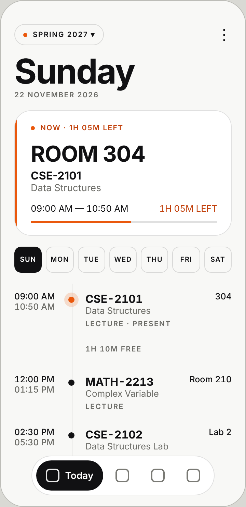
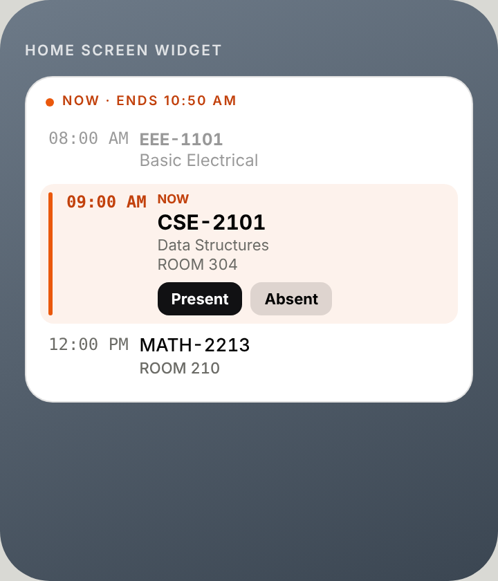
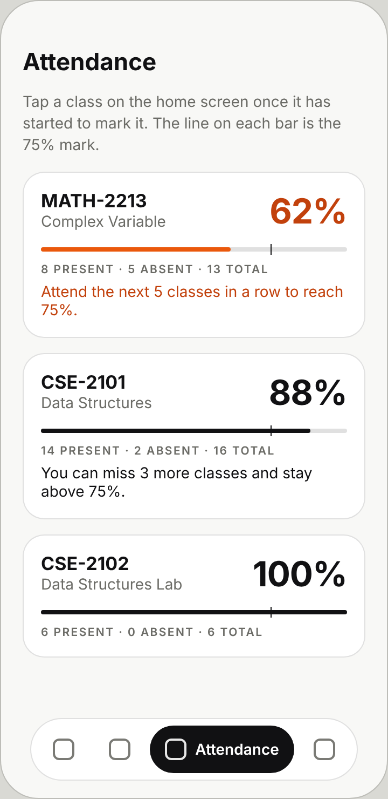
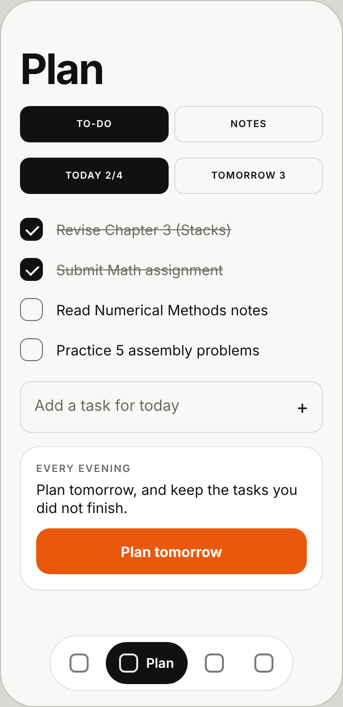
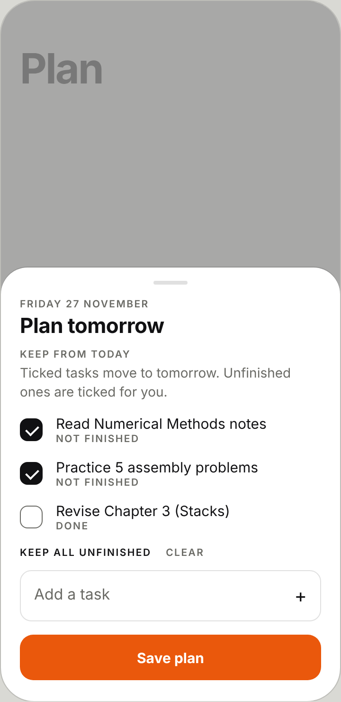
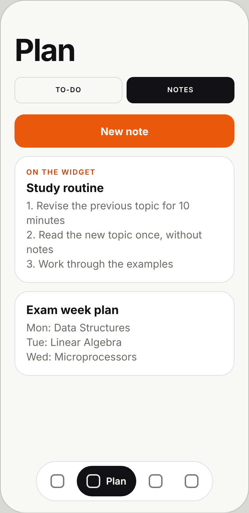
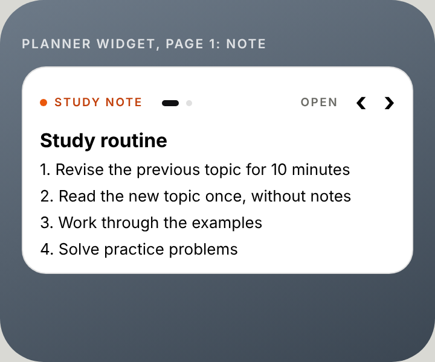
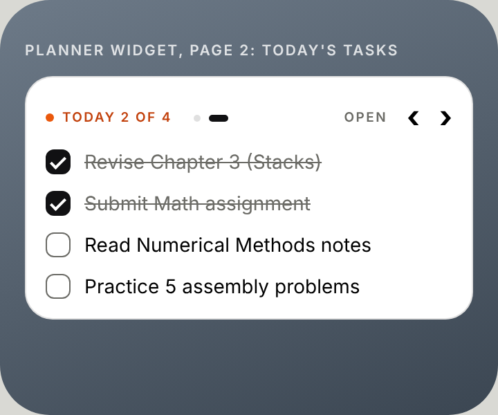
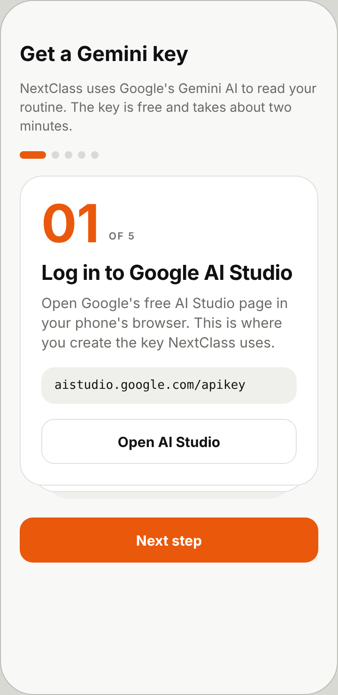
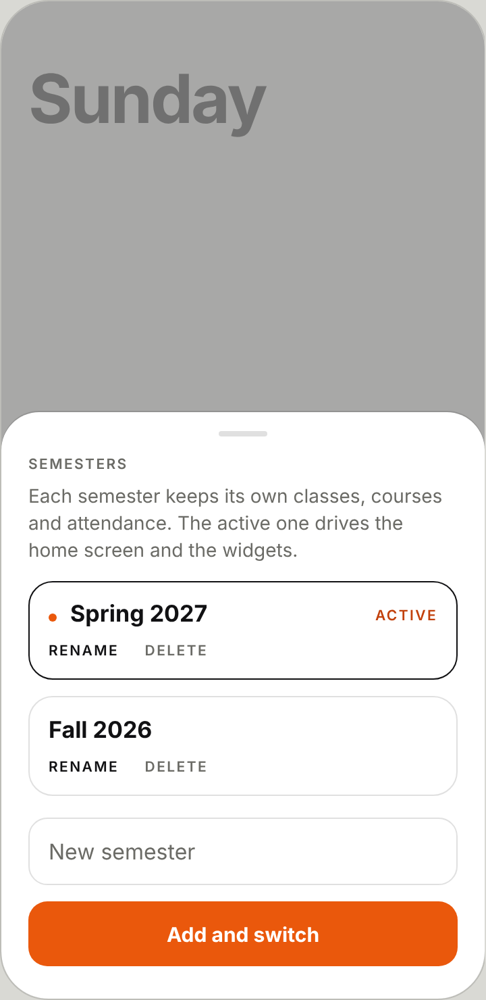

# NextClass

A precision class-routine app for Android. Import your university timetable as a PDF or image, let Gemini extract the sessions, review them, and get a home screen widget that lists your whole day with the current or next class highlighted.

Built for a small private group of students. Each person brings their own free Gemini API key. There is no backend server.

## Preview

These are design previews of the main screens, drawn to match the app's layout and palette. Replace them with real device screenshots in `docs/images` when you have them.

**Schedule**

<p align="center">
  
  
  
</p>

**To-do list and notes**

<p align="center">
  
  
  
</p>

**Planner widget (note page, then tasks page)**

<p align="center">
  
  
</p>

**Setup and semesters**

<p align="center">
  
  
</p>

## Features

- **Routine import.** Pick a PDF or image (JPG/PNG) of your timetable. PDFs are rendered page by page at high resolution with `PdfRenderer`. An optional section or group filter (for example `Section A, Group A1`) isolates your classes from multi-section timetables.
- **AI extraction.** The pages are sent to the Gemini API (`gemini-3.8-flash`, falling back to `gemini-2.5-flash`) with a strict JSON response schema. Merged lab cells span from the first start time to the last end time, and break rows are ignored.
- **Review before saving.** Parsed classes are grouped by day. Tap a row to edit room or time, swipe to delete a wrong entry, or add a class manually.
- **Full-day widget.** The home screen widget lists every class of the day:
  - the ongoing class, or the next one when nothing is running, is highlighted with a vermilion accent
  - classes that already finished are faded
  - once the last class is over, the widget shows the next scheduled day
- **Compact widget.** A one-row widget, "NextClass (compact)", that shows only the ongoing or next class.
- **Widget theme.** Follow the phone, or force light or dark, in Settings.
- **12-hour time.** Times show as `09:00 AM` everywhere, and you can type times as `9:00 AM`, `2:30 pm` or `14:30`.
- **One-day changes.** Tap a class on the home screen to cancel it for one date or use a different room that day. The widget, the hero card and the reminder follow the change, and it resets by itself afterwards.
- **Free-time gaps.** Gaps of 20 minutes or more between classes show as `2H 10M FREE`.
- **Course list.** Upload a photo or PDF of your course codes and titles. Titles are filled into every class with a matching code.
- **Week overview.** A "This week" screen shows every day as a card. Today is outlined in vermilion, finished classes are faded, and tapping a day opens it on the home screen.
- **Course titles in the widgets.** Both widgets show the course title under the course code.
- **API key guide.** A step-by-step card guide (Settings, or the notice on Home) covers getting a free Gemini key, privacy, and troubleshooting.
- **Smooth motion.** Screens slide and fade, cards and lists ease in, day pills and buttons animate, and help cards expand smoothly.
- **Share and backup.** Share your routine as a code message for friends, save a backup file, and restore from a backup or a pasted code.
- **Attendance tracker.** Tap a class once it has started and mark it Present or Absent. The Attendance screen shows a percentage per course with a 75% line, tells you how many classes you can still miss or how many to attend in a row to recover, and lets you mark earlier classes from the last three weeks. Marks are included in backup files, not in share codes.
- **Scan review flags.** After a scan, rows the AI may have misread (missing room, overlap, duplicate, odd time or length, odd course code) are marked with a vermilion dot and a reason. A "Needs check" filter shows only those rows.
- **Update check.** Settings checks the latest GitHub release against the installed build and offers the APK download. A quiet check also runs at most once a day and shows a banner on Home. The build number is the CI run number.
- **Battery help.** Settings and a dismissible Home notice ask Android to let NextClass run in the background, with extra tips for Xiaomi, Oppo, Vivo, Samsung and Huawei phones.
- **Multiple semesters.** Tap the semester chip on Home to add, switch, rename or delete semesters. Each one has its own classes, courses and attendance, and only the active one drives the widgets and the reminder. Existing data moves into "Semester 1". Backups and share codes cover the active semester.
- **Widget attendance buttons.** The ongoing class in both widgets has Present and Absent buttons. Tap the chosen one again to clear it.
- **Material You.** Settings, Appearance: keep the NextClass look or take colors from your wallpaper (Android 12+), in the app and on the widgets.
- **New navigation and look.** A floating dock for Today, Plan, Attendance and Settings (Week is the calendar icon on Home); a timeline rail with a pulsing live node; a large day header; softer corners.
- **Key setup cards.** The API key guide is a deck of step cards with Next and Back, an Open AI Studio button, and paste-and-verify on the last card.
- **Daily to-do list.** Plan tab, To-do: add tasks for today or tomorrow, tick them off, delete them. Tasks are kept per date and old ones clear themselves after two weeks.
- **Evening plan reminder.** At a time you choose in Settings (7, 8, 9 or 10 PM) NextClass asks you to plan tomorrow, and stays quiet if tomorrow already has tasks. The plan sheet lists today's tasks with unfinished ones ticked, so one tap keeps them for tomorrow, and you can add new tasks in the same place. This is a second, separate notification from the first-class reminder, and you can turn it off.
- **Study notes.** Plan tab, Notes: keep your study process, for example "revise the previous topic before starting a new one", with a ready-made study routine template. Pin one note to show it on the widget. Notes are included in backup files, not in share codes.
- **Planner widget.** One widget, "NextClass (notes and tasks)": the first page is your pinned note and the second page is today's tasks. Tap the arrows or the page name to flip pages, and tap a task to tick it. Android widgets built with Glance cannot swipe between pages, so the arrows do the flipping.
- **One notification per day.** A single reminder for the first class of the day, with a configurable lead time (15, 30 or 45 minutes). No reminders for later classes.
- **No background polling.** The widget refreshes through one exact alarm set for the next start or end time.
- **Private by design.** The API key is stored with `EncryptedSharedPreferences` and never leaves the device except in requests to Google.

## Design

Swiss-grid, utility-first. Warm off-white (`#F8F8F6`) in light mode and true obsidian (`#0E0E10`) in dark mode, flat surfaces with 1dp hairline borders, and a single Signal Vermilion accent reserved for live and highlighted states. Times and countdowns use tabular figures. There are no gradients, no emojis and no nested shadowed cards.

## Tech stack

| Area | Library |
| --- | --- |
| UI | Jetpack Compose, Material 3 |
| Widget | Jetpack Glance (`glance-appwidget`) |
| Storage | Room with KSP |
| Key storage | AndroidX Security Crypto |
| Networking | Retrofit, OkHttp, Kotlinx Serialization |
| Scheduling | AlarmManager, WorkManager, boot receiver |
| Build | Gradle (Kotlin DSL), version catalog, GitHub Actions |

Requirements: JDK 17, Android SDK 35, minimum Android 8.0 (API 26).

## Project structure

```
app/src/main/java/com/example/nextclass/
  data/local      Room entity, DAO, database, encrypted key storage, preferences
  data/remote     Gemini API service, DTOs, PDF/image parsing repository
  domain          Models, current-or-next-class resolver, daily alarm use case
  ui              Theme, components, screens (home, import, courses, settings), ViewModel
  widget          Glance widget, receiver, update helper
  worker          Alarm helper, notification and boot receivers, daily worker
```

## Build

### On GitHub (no Android Studio needed)

1. Create a repository and push this project to the `main` branch.
2. Open the **Actions** tab and wait for **Build Android APK** to finish. You can also start it manually with **Run workflow**.
3. Open the finished run and download **NextClass-Debug-APK** from the artifacts section.
4. Unzip it and install `app-debug.apk` on your phone.

### Locally

```
./gradlew assembleDebug
```

The APK is written to `app/build/outputs/apk/debug/app-debug.apk`. No API key or secret is needed to compile.

### Optional: signed release build

Set these environment variables before running `./gradlew assembleRelease`:

```
NEXTCLASS_KEYSTORE_PATH
NEXTCLASS_KEYSTORE_PASSWORD
NEXTCLASS_KEY_ALIAS
NEXTCLASS_KEY_PASSWORD
```

Never commit a keystore. `*.jks` and `*.keystore` are already in `.gitignore`.

## First run

1. Get a free API key from [Google AI Studio](https://aistudio.google.com/app/apikey).
2. Open NextClass, go to **Settings**, paste the key and tap **Verify Key**.
3. Tap **Import Routine**, choose your timetable PDF or image, optionally enter your section or group, and start the scan.
4. Check the parsed classes, fix anything wrong, and save.
5. Long-press your home screen, add the **NextClass** widget, and resize it to fit your day.
6. Allow notifications and exact alarms when Android asks, so the widget updates on time and the first-class reminder fires.

## Permissions

| Permission | Why |
| --- | --- |
| `INTERNET` | Send the routine to the Gemini API |
| `POST_NOTIFICATIONS` | First-class reminder |
| `SCHEDULE_EXACT_ALARM` | Update the widget and send the reminder at the exact minute |
| `RECEIVE_BOOT_COMPLETED` | Rebuild alarms after a reboot, update or clock change |

## Troubleshooting

- **Widget does not change at class time.** Allow exact alarms for NextClass in system settings, and exclude the app from aggressive battery optimization if your phone vendor kills background alarms.
- **Scan returns nothing or the wrong classes.** Use a sharper image or the original PDF, and add a section or group filter. You can fix any row on the review screen.
- **Key verification fails.** Check that the key starts with `AIza`, that it is active in Google AI Studio, and that the phone is online.
- **Build fails on GitHub.** Open the failed run, copy the Gradle error from the **Build Debug APK** step, and fix the dependency or code it points at.

## License

Private project for personal and group use.
